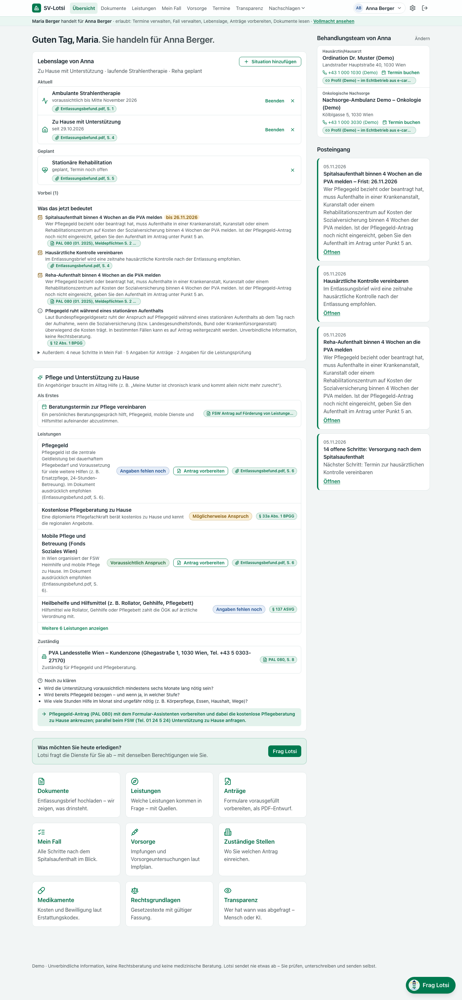
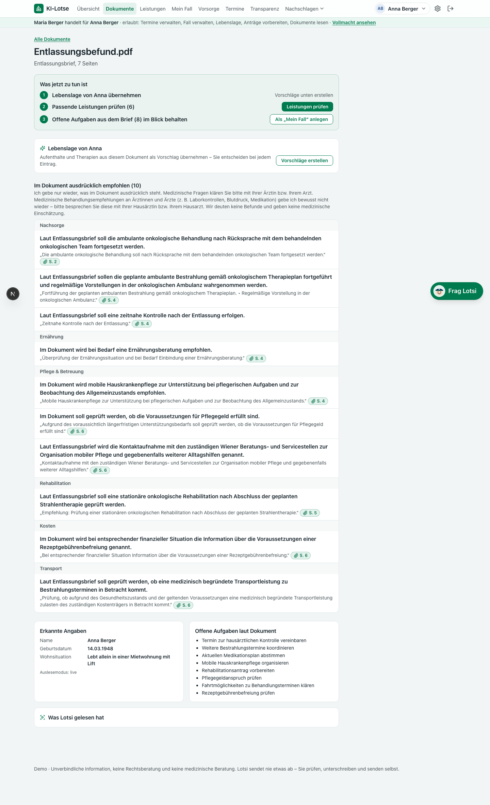
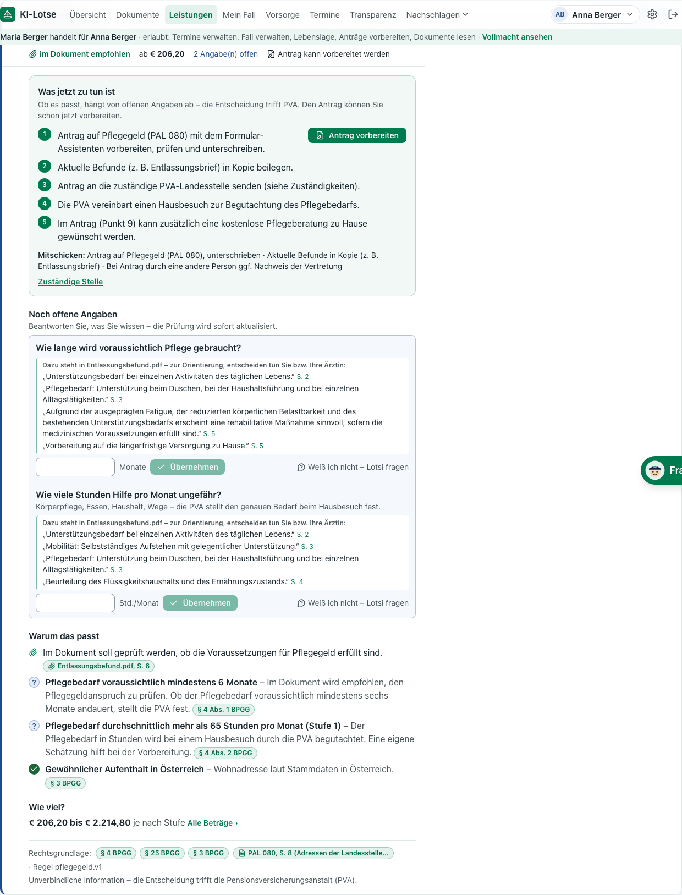
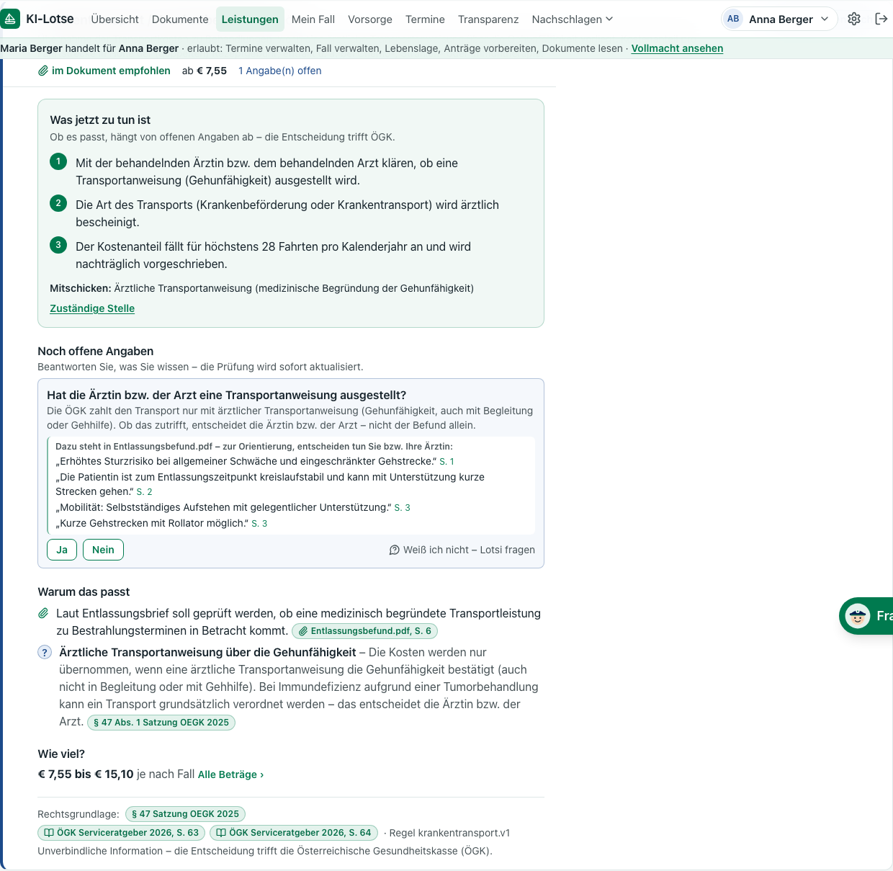
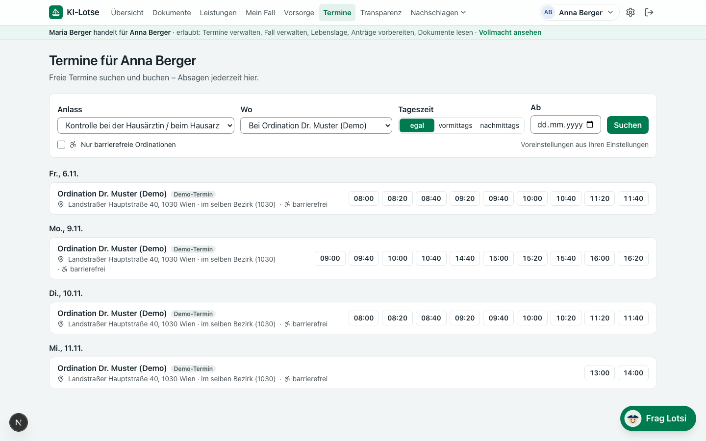
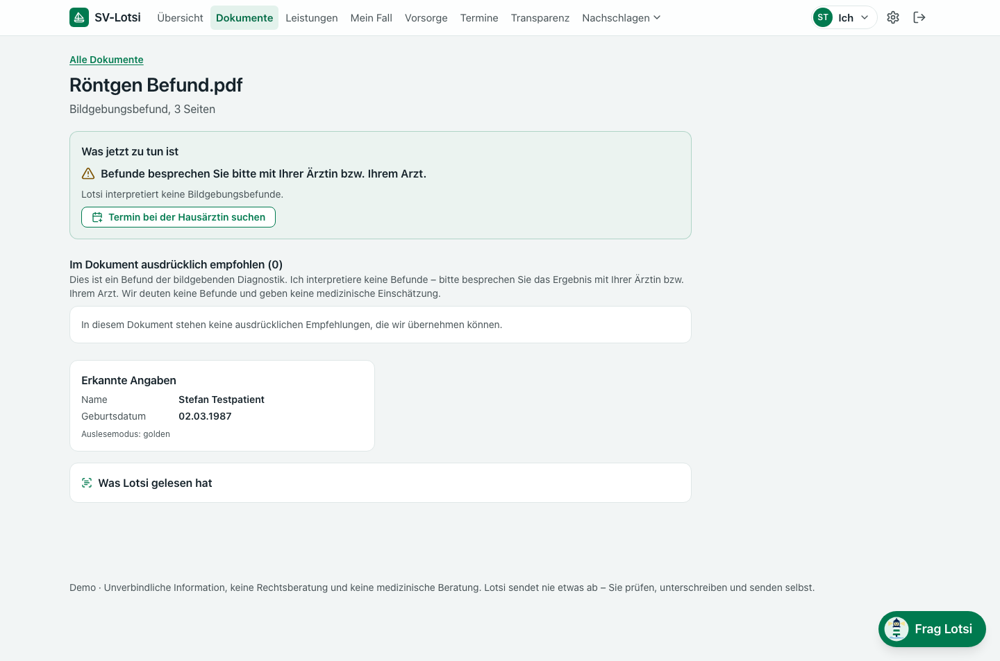
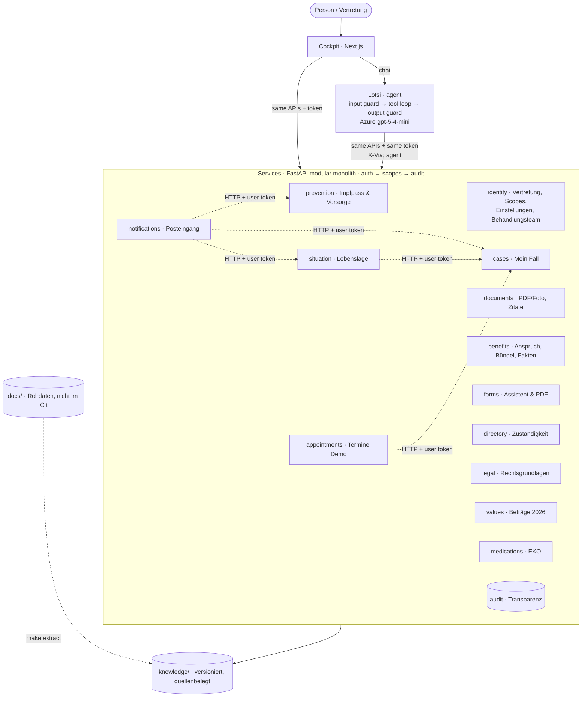

# SV KI-Lotse („Lotsi“)

## Deutsch – Für die Jury

**Problem.** Wer nach einem Spitalsaufenthalt Pflege organisieren, eine Reha beantragen oder für ein Kind Leistungen finden will, muss heute selbst herausfinden, was zusteht, wer zuständig ist, welche Formulare nötig sind und welche Fristen gelten.

**These.** *KI funktioniert nur gut und vor allem sicher, wenn Prozesse definiert sind. Wir bauen sie als Top Layer auf unsere anderen Services.*

**Lösung.** Ein Cockpit aus klar definierten, quellenbelegten Services – und darüber **Lotsi**, der KI-Lotse. Lotsi versteht das Anliegen, stellt nur die nötigen Rückfragen und ruft dieselben Services auf wie die Oberfläche – mit genau den Rechten der Person, nie mehr.

**Was das Cockpit kann**
- **Vertretung:** Maria handelt für ihre Mutter Anna – mit fein granularen Berechtigungen, die Anna jederzeit ändern kann. Die KI erbt nur diese Rechte.
- **Lebenslage:** Krankenhaus, Reha, Therapie, zu Hause mit Unterstützung … als Zeitleiste. Aus dem Entlassungsbrief kommen nur **Vorschläge** (mit Zitat und Seite); sie gelten erst nach „Ja, übernehmen“. Danach wirken sie überall: **Meldepflicht-Erinnerungen** im Posteingang (z. B. Spitalsaufenthalt binnen 4 Wochen an die PVA melden), **Fakten** für die Anspruchsprüfung, **Vorbefüllung** von Anträgen (PAL 080 § 5), neue **Schritte in „Mein Fall“**.
- **Dokumente:** PDF oder **Foto** des Briefs hochladen. Übernommen wird nur, was ausdrücklich drinsteht – jedes Zitat wird deterministisch gegen die Seite geprüft. Klinische Anweisungen (Laborwerte, Medikation …) gibt Lotsi bewusst nicht wieder. Bei Fotos: „Was Lotsi gelesen hat“ und der Hinweis „bitte prüfen“.
- **Leistungen & Bündel:** 20 Leistungen und 13 Gesundheitsförderungs-Angebote, deterministische Anspruchsprüfung mit Quelle pro Kriterium, Beträge aus den Wertetabellen 2026. 5 **Lebenssituationen** („Pflege zu Hause“, „Nach dem Spital“, „Gesundheit fördern“, „Kind“, „Finanzielle Entlastung“) bündeln Leistungen, Angebote, Vorsorge, Formulare, Termine und zuständige Stellen.
- **Anträge:** 4 offizielle Formulare (PAL 080 Pflegegeld, FSW-Förderantrag, Kur/Reha S. 1, ÖGK-Fahrtkosten) – Assistent und Chat arbeiten am **selben** Entwurf. Diagnosen werden **wörtlich** aus dem Brief in PAL 080 „Krankheiten“ übernommen (nie gedeutet). Ergebnis: das offizielle PDF als **ENTWURF** zum Prüfen und Unterschreiben.
- **Behandlungsteam & Termine (Demo):** Hausärztin und Ambulanz der Person; freie Termine nach Vorlieben (vormittags, in der Nähe, barrierefrei), Buchung erst nach ausdrücklicher Wahl, Mitbringliste, Kalenderdatei. Alle Termine sind als Demo gekennzeichnet.
- **Vorsorge:** e-Impfpass, Impfplan und Vorsorgeuntersuchung proaktiv; Familiengeschichte erklärt das offizielle Programm – ohne Risikozahlen.
- **Gemeinsames Wissen:** Was die Person im Cockpit oder Lotsi beantwortet hat, wird mit Herkunft gespeichert („Angabe von Maria, Datum, Cockpit/Lotsi“) und nie wieder gefragt.
- **Einstellungen:** Detailtiefe (kurz/normal/ausführlich), Einfache Sprache, Sprache (Antworten auch auf Englisch/Türkisch), Spracheingabe, Termin-Vorlieben.
- **Transparenz:** Jede Abfrage – Mensch, KI oder Service – mit Werkzeug, Berechtigung und Quellen; verweigerte rot.

**Demo-Szenarien** (Drehbuch: [documentation/demo-script.md](documentation/demo-script.md))
1. **Pflege nach dem Spital:** Maria fotografiert Annas Entlassungsbrief → Empfehlungen mit Zitat → Lebenslage übernehmen → Pflegegeld 206,20 € (Werte-Tabelle 2026, nicht der veraltete § 5 BPGG) → PAL 080 per Chat vorbereitet → Pflegeberatung per Chat im offenen Assistenten → PDF-Entwurf → Meldepflicht im Posteingang → Kontrolltermin bei der Hausärztin → Mein Fall.
2. **Grenze:** „Ist ihr Tumor jetzt weg?“ → freundliche Absage in < 1 s, ohne Modellaufruf, mit Angebot (Termin, Fragen fürs Arztgespräch).
3. **Berechtigungen:** Anna entzieht „Anträge vorbereiten“ → auch Lotsi kann es nicht mehr; im Protokoll sichtbar.
4. **Gesundheit fördern:** Stefan – Vorsorgeuntersuchung, fällige Grippeimpfung, Bewegt im Park, Familiengeschichte Darmkrebs.

**Sicherheit & Grenzen** (Details: [documentation/safety.md](documentation/safety.md))
- Keine Diagnosen, keine Befundinterpretation, keine Prognosen, keine Therapie- oder Medikamentenempfehlungen. Diagnosen wörtlich abschreiben – ja; deuten – nie.
- Jede Aussage mit Quelle: Gesetz (§ + Fassung), Werte-Tabelle (Jahr), Serviceratgeber (Seite), Formular, Dokument (Zitat + Seite).
- Beträge kommen aus den amtlichen Wertetabellen; ein Prüfschritt verwirft jeden Betrag, den kein Service geliefert hat.
- Nichts wird eingereicht. Zustimmungs-Häkchen setzt nur die Person selbst. Dokument-Vorschläge gelten erst nach Zustimmung.
- Ehrliche Herkunft: „ID Austria“ nur für Name/Geburtsdatum, ZMR für die Adresse, e-card für SVNR/Träger, Rest „Profilangaben – bitte prüfen“; Demo-Termine und Demo-Profile sind gekennzeichnet.



| | |
|---|---|
|  |  |
| Dokument: ausdrücklich empfohlene Schritte mit Zitat + Seite | Pflegegeld: Kriterien mit Quelle, Betrag aus veraendW 2026 |
|  |  |
| Offene Angabe mit Belegstellen | Termine bei der Hausärztin (Demo-Termine) |
|  | |
| Röntgenbefund: keine Interpretation | |

---

## Quickstart
```bash
cp .env.example .env        # AZURE_ENDPOINT_URL, AZURE_API_KEY (optional: without a key the app runs offline: goldens + scripted agent)
make setup                  # backend (uv) + frontend (npm)
make test                   # all tests, no key and no raw data needed
make dev                    # API http://localhost:8000/docs · cockpit http://localhost:3000 (API with --reload)
```
Demo setup (needs the raw challenge data in `docs/`, gitignored):
```bash
make reset && make seed     # empty the DB in place + load demo documents and Stefan's e-Impfpass
                            # then RESTART the API – it keeps delegations in memory
make demo-assets            # 4 JPG "photos" of the discharge letter into var/demo/ (needs Ghostscript)
make api-demo               # API without --reload (stable state during the pitch); `make web` in a 2nd terminal
make demo-check             # preflight: 16 checks of the demo-script scenes against the running API (no state change)
```
Other targets: `make eval` (live agent evals, needs a key) · `make lint` · `make openapi` (spec + TS types) · `make extract` (docs/ → knowledge/extracted) · `make sources` (regenerate [documentation/sources.md](documentation/sources.md)) · `make smoke-llm`.

## Architecture

Services compose each other over HTTP with the **user's own token**, so scopes apply transitively (no Vorsorge scope → no Vorsorge hints in the inbox). Details: [architecture.md](documentation/architecture.md) · [safety.md](documentation/safety.md) · endpoints and scopes: [services.md](documentation/services.md) · decisions: [documentation/decisions/](documentation/decisions/) · roadmap: [roadmap.md](documentation/roadmap.md).

Interactive architecture map (Floorplan export, open in a browser): [documentation/floorplan/sv-ki-lotse.html](documentation/floorplan/sv-ki-lotse.html)

## Services
14 services + agent, 69 operations on 61 paths (OpenAPI at `/docs`).

| Service | Purpose | Status |
|---|---|---|
| identity | mock ID Austria, delegations with 6 scopes (AI inherits them), preferences, Behandlungsteam | ✅ |
| situation | Lebenslage episodes; document suggestions only with consent; effects: reminders, facts, prefill, case steps | ✅ |
| documents | PDF/photo upload, explicitly documented recommendations with verified quote + page, clinical filter, admin facts | ✅ |
| benefits | 20 benefits + 13 offers, deterministic eligibility, 5 situation bundles, shared known facts | ✅ |
| prevention | e-Impfpass parser, 10 Impfplan/Vorsorge rules, 4 family-history explanations | ✅ |
| forms | 4 official AcroForms; wizard + chat share one session; official PDF filled as draft | ✅ |
| cases | Mein Fall: steps from documented tasks, benefits, Lebenslage and appointments | ✅ |
| appointments | 29 providers (13 real, 16 demo practices), reproducible demo slots by preference, booking, `.ics` | ✅ |
| notifications | inbox composed from prevention, situation and cases APIs | ✅ |
| directory | 28 offices (ÖGK Wien, PVA Landesstellen, FSW, 1450) by topic + postcode | ✅ |
| legal | 1,976 SozDok paragraphs (19 laws) with in-force date, FTS5/BM25 search | ✅ |
| values | veraendW 2026 amounts (the only source for amounts with a table) | ✅ |
| medications | Erstattungskodex lookup (6,985 packs), administrative only | ✅ |
| audit | transparency log of every call (UI, agent, service; incl. denied) | ✅ |
| agent (Lotsi) | 30 tools (one per endpoint), input boundary guard, output guard, deterministic post-processing, 403-aware | ✅ |

**Tests:** `make test` → 250 passed (244 API + 6 extraction), 6 skipped (need `docs/`), no key needed. `make lint` clean.
**Evals (live, `gpt-5-4-mini`):** [evals/REPORT.md](evals/REPORT.md) — **34/34**: 10 scenarios (hero, Lebenslage, bundles, appointment, family history, diagnosis copy …), 20 boundary/red-team prompts (diagnosis, findings, prognosis, medication, emergency, suicide, doctor sections, submit, role play, EN/TR, prompt injection in message and PDF), 2 delegation, 2 language. Boundary refusals answer in < 0.2 s without any LLM call.

## Data & sources
Raw challenge data lives in `docs/` (gitignored). `make extract` deterministically produces `knowledge/extracted/` with a `MANIFEST.json` (source hashes): 1,976 legal paragraphs from 19 laws (SozDok), veraendW value tables (5 tables mapped, 686 rows), Erstattungskodex (6,985 packs), ÖGK Serviceratgeber 2026 (118 pages, page-accurate), 7 official form templates (all AcroForms, 4 mapped). Curated YAML (`knowledge/*.yaml`) cites a source for every entry; `make sources` lists them all in [documentation/sources.md](documentation/sources.md). Fictional medical documents (Befunde) are never committed.

## Project structure
```
apps/web/            Next.js cockpit (German UI)
services/api/        FastAPI: app/{core,contracts,services/*,agent,seed}
knowledge/           extracted + curated knowledge (committed)
tools/               extract/ (docs/ -> knowledge/), demo_check.py, sources.py
evals/               scenario + boundary evals, goldens
documentation/       architecture, safety, services, sources, roadmap, decisions, demo script, screenshots
CLAUDE.md            rules for AI coding sessions · PROGRESS.md  progress board
```

## Roadmap
Real ID Austria / e-Vollmacht · ELGA & e-Impfpass API · Träger e-services and status feedback · real appointment systems · more Träger (SVS, BVAEB) and offices outside Wien · microservice split along the existing boundaries · operations/monitoring · accessibility audit. Details: [documentation/roadmap.md](documentation/roadmap.md).

## AI usage disclosure
Built in 24 h by one person with Claude Code: multiple parallel agent sessions (one per workstream, own branch/worktree) coordinated via `CLAUDE.md`, `PROGRESS.md` and the workstream briefs in `documentation/briefs/`; an integrator session merged and reviewed. Runtime model: Azure AI Foundry `gpt-5-4-mini`, used only for document extraction, photo transcription, the agent loop and a boundary double-check — never for eligibility, amounts or deadlines.
