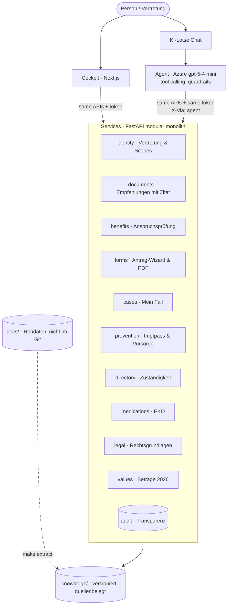

# SV KI-Lotse

## Deutsch – Für die Jury

**Problem.** Wer nach einem Spitalsaufenthalt Pflege organisieren, eine Reha beantragen oder für ein Kind Leistungen finden will, muss heute selbst herausfinden, was zusteht, wer zuständig ist und welche Formulare nötig sind.

**These.** *KI funktioniert nur gut und vor allem sicher, wenn Prozesse definiert sind. Wir bauen sie als Top Layer auf unsere anderen Services.*

**Lösung.** Ein Cockpit mit klar definierten, quellenbelegten Services (Leistungen & Anspruchsprüfung, Dokumente, Anträge, Mein Fall, Vorsorge, Zuständigkeiten, Medikamente, Rechtsgrundlagen, Transparenz). Der KI-Lotse ist ein Top Layer darüber: Er versteht das Anliegen, stellt nur die nötigen Rückfragen und ruft dieselben Services auf wie die Oberfläche – mit genau den Rechten der Person, nie mehr.

**Demo-Szenarien**
1. **Pflege nach dem Spital:** Maria handelt (per Vertretung) für ihre Mutter Anna, lädt den Entlassungsbrief hoch → ausdrücklich dokumentierte Empfehlungen mit Zitat und Seite → Anspruchsprüfung (Pflegegeld, Reha, mobile Pflege, Fahrten, Rezeptgebühr) → offizieller Pflegegeld-Antrag vorausgefüllt (Wizard oder Chat) → Mein Fall → Transparenz-Protokoll.
2. **Vorsorge:** Stefan sieht proaktiv, dass die Grippeimpfung fällig ist und die Vorsorgeuntersuchung kostenlos ist; für seine Tochter Lena: Familienleistungen.
3. **Grenze:** Ein Röntgenbefund wird nicht interpretiert – der Lotse verweist an die Ärztin und hilft bei Termin und Zuständigkeit.

**Sicherheit & Grenzen**
- Keine Diagnosen, keine Befundinterpretation, keine Therapie- oder Medikamentenempfehlungen.
- Jede Aussage mit Quelle: Gesetz (§ + Fassung), Werte-Tabelle (Jahr), Serviceratgeber (Seite), Dokument (Zitat + Seite).
- Beträge kommen aus den amtlichen Wertetabellen, nicht aus dem Sprachmodell.
- Vertretung mit fein granularen Berechtigungen; die KI erbt nur die Rechte der Person.
- Nichts wird automatisch eingereicht – Anträge sind Entwürfe zum Prüfen und Unterschreiben. Jeder Zugriff wird protokolliert.

## Quickstart
```bash
cp .env.example .env        # AZURE_ENDPOINT_URL, AZURE_API_KEY (optional: without key the app runs in offline mode)
make setup                  # backend (uv) + frontend (npm)
make test                   # all tests, no key and no raw data needed
make dev                    # API http://localhost:8000/docs · Cockpit http://localhost:3000
```

## Architecture

Details: [documentation/architecture.md](documentation/architecture.md) · interactive map: Floorplan (see below).

## Services
| Service | Purpose | Status |
|---|---|---|
| identity | mock ID Austria, delegation with scopes (AI inherits them) | ✅ |
| audit | transparency log of every call (UI + agent, incl. denied ones) | ✅ |
| documents | explicitly documented recommendations, verbatim quote + page, deterministic quote check | ✅ |
| benefits | 14 benefits, deterministic eligibility, every criterion source-cited | ✅ |
| forms | 4 official forms (PAL 080, FSW, Kur/Reha p.1, Fahrtkosten): wizard + chat share one session, official PDF filled as draft | ✅ |
| cases / notifications | Mein Fall from documented tasks; inbox composed via APIs (scopes apply transitively) | ✅ |
| prevention | e-Impfpass parser + Vorsorge/Impfplan rules | ✅ |
| directory | ÖGK Wien, PVA Landesstellen, FSW, 1450 by topic/PLZ | ✅ |
| legal / values / medications | SozDok paragraphs (FTS5), 2026 amounts (veraendW), EKO lookup | ✅ |
| agent | AI top layer: 18 tools, input boundary guard, output guard, 403-aware | ✅ |

**Evals (live, `gpt-5-4-mini`):** see [evals/REPORT.md](evals/REPORT.md) — 28/28: 4 scenarios, 19 boundary/red-team prompts (diagnosis, findings, prognosis, medication, emergencies, doctor sections, submit, role play, prompt injection, EN/TR), delegation 403 cases, language. Boundary refusals answer in < 0.2 s without any LLM call.

## Data & sources
Raw challenge data lives in `docs/` (gitignored). `make extract` deterministically produces `knowledge/extracted/` with a `MANIFEST.json` (source hashes): 1,976 legal paragraphs from 19 laws (SozDok), veraendW value tables, Erstattungskodex (6,985 packs), ÖGK Serviceratgeber 2026 (page-accurate), 7 official form templates (all fillable). Fictional medical documents (Befunde) are never committed.

## Project structure
```
apps/web/            Next.js cockpit (German UI)
services/api/        FastAPI: app/{core,contracts,services/*,agent,seed}
knowledge/           extracted + curated knowledge (committed)
tools/extract/       deterministic extractors (docs/ -> knowledge/)
evals/               scenario + boundary evals
documentation/       architecture, briefs, decisions, roadmap, demo script
CLAUDE.md            rules for AI coding sessions · PROGRESS.md  progress board
```

## Roadmap
Real ID Austria / e-Vollmacht · ELGA & e-Impfpass API · real appointment booking · notifications (push/SMS) · more Träger (SVS, BVAEB) · split services into independently deployable microservices along the existing boundaries.

## AI usage disclosure
Built in 24 h by one person with Claude Code (multiple parallel agent sessions coordinated via `CLAUDE.md`, `PROGRESS.md` and workstream briefs). Runtime model: Azure AI Foundry `gpt-5-4-mini`.
